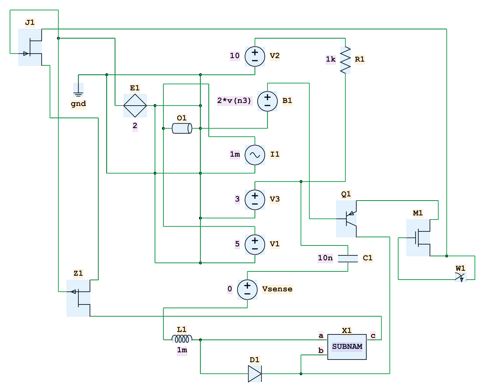
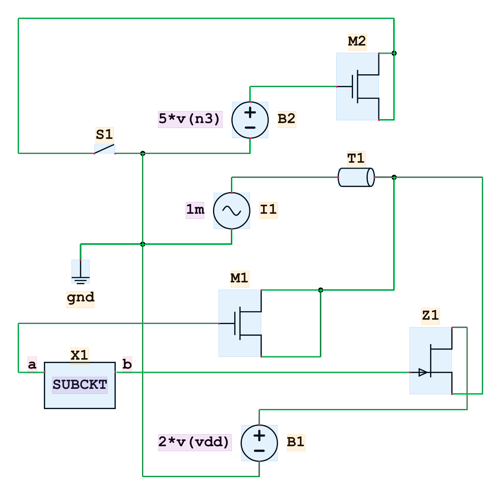
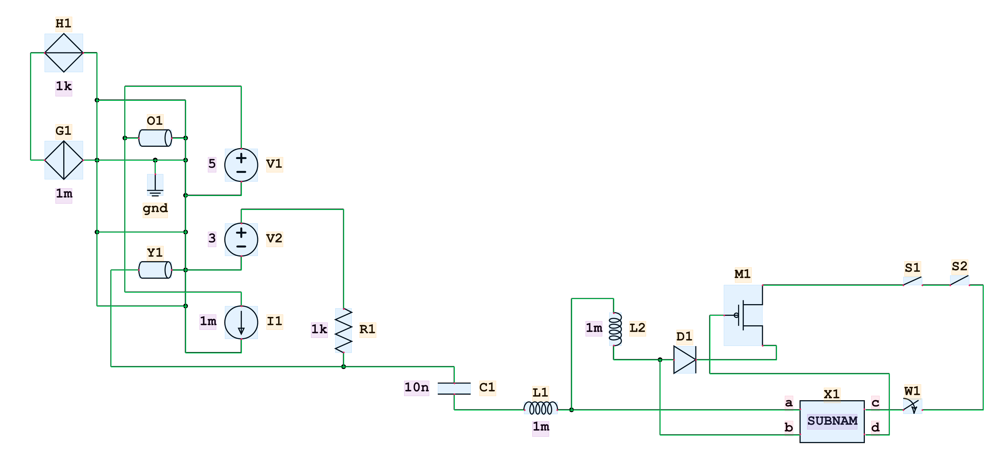
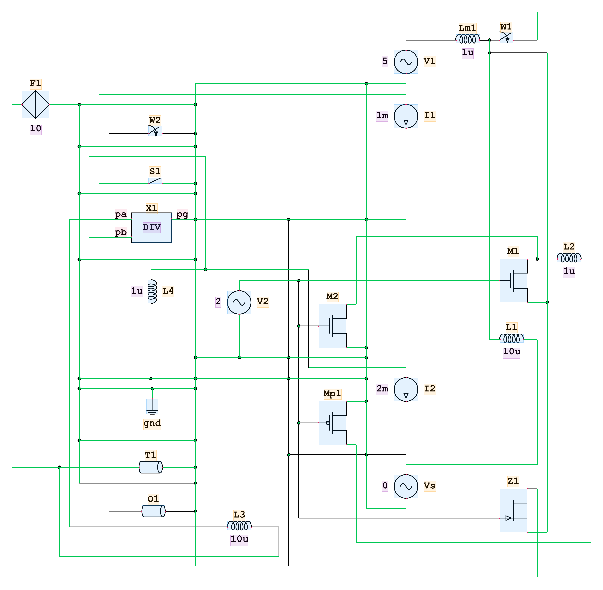

# Circuit Data Generation

This repository contains a tool for generating circuit data: **netlists**, **rendered schematics** (SVG/PNG/JPG), and **annotations** (bounding boxes of components and labels, exact pin coordinates). By default the validation is structural: every netlist parses, renders, uses the requested components and forms one connected circuit. With `--strict`, each netlist must also be valid [ngspice](https://ngspice.sourceforge.io/) input: it passes strict SPICE parsing, and ngspice (when installed) must load it.
[An example dataset](https://github.com/Cab14bacc/spice-circuit-dataset.git).
The pipeline is:

1. Generate a random netlist using an LLM. The netlist is a [SPICE](https://ngspice.sourceforge.io/docs/ngspice-manual.pdf) netlist in the ngspice dialect, limited to the supported components. Their grammar is in the docstring of `circuit_data_gen/configs/convert/spice_convert_config.py` and in the system prompt (`circuit_data_gen/netlist_gen/prompts/spice_agent_system_prompt.md`); `config_to_grammar()` in `parser/grammar.py` renders it from the config.
2. Validate the candidate with a smoke test: the netlist must parse, render, contain the required components, and form a single electrically-connected graph. With `--strict`, it must also pass strict SPICE parsing and load in ngspice (when installed). Invalid candidates are fed back to the LLM with the error messages for regeneration.
3. Render the validated netlist to a schematic using our [netlistsvg fork](https://github.com/Cab14bacc/netlistsvg). netlistsvg lays out the netlist with ELK (a multipurpose graph layout algorithm) and draws components from a **skin file** (SVG). The default skin is `dataset/skins/skin.svg`, built by `circuit_data_gen/build_skin.py`. Read more about skins in [docs/SKIN_STRUCTURE.md](docs/SKIN_STRUCTURE.md).
4. Emit structured **annotations** alongside the render: component bounding boxes, nested label (ref/value) boxes, exact pin coordinates, and the drawn wires of every net — all in output-image coordinates.

This loop is executed concurrently.



## Prerequisites

- **Python >= 3.12**
- **Node.js** (for netlistsvg)
- **Poppler** for `pdftocairo` — used by the skin builder to rasterize LaTeX output. Linux (Ubuntu/Debian):

  ```bash
  sudo apt update
  sudo apt install poppler-utils
  ```

  Windows/macOS: precompiled binaries from the [poppler website](https://poppler.freedesktop.org/).

- **MiKTeX** for `pdflatex` — used by the skin builder to draw each component with CircuitTikZ. Follow the instructions on the [MiKTeX website](https://miktex.org/download). The `circuitikz` package is installed automatically: the MiKTeX console pops up and prompts for it the first time `build_skin` runs.

## Installation

```bash
# clone with submodules, we use the netlistsvg fork from
# https://github.com/Cab14bacc/netlistsvg.git
git clone --recurse-submodules https://github.com/Cab14bacc/Circuit-Detection-Data-Generation.git
cd Circuit-Detection-Data-Generation
pip install -e .

# install the netlistsvg fork's node dependencies (the renderer runs via node)
cd netlistsvg
npm install
cd ..
```

This exposes the `cirdg` (circuit data generation) command.

### Optional: ngspice smoke test (`--strict`)

Strict generation also loads every netlist that passed the render smoke test into ngspice, which must accept it. ngspice reads the netlist and runs an operating point so that setup errors show up too, but the result is not checked: a netlist that does not converge is still accepted. It needs an ngspice **console** executable, found on `PATH` as `ngspice_con` (Windows) or `ngspice`, or set with `NETLIST_GEN_CONFIG["NGSPICE_PATH"]` in `config.py` (`NGSPICE_TIMEOUT_S` bounds each run). Without one, strict generation still runs and logs a warning that the ngspice step is skipped.

The grammar and the strict parser are checked against **ngspice 47**. Other versions accept or reject some lines differently (ngspice 32, for one, rejects `C1 a b Q={2n}`), so strict generation logs a warning when the ngspice it finds reports another version.

#### Linux (Ubuntu/Debian)

To install ngspice 47 on linux, we have to manually compile it.

```bash
# any platform, into the active conda environment
cd install_folder

# sudo -s, to grant root permission to shell if don't have permission 
# to create directories  
curl -L -o ngspice-47.tar.gz https://sourceforge.net/projects/ngspice/files/ng-spice-rework/47/ngspice-47.tar.gz/download
tar -xzvf ngspice-  47.tar.gz
sudo apt update
sudo apt install -y bison flex libx11-dev libxaw7-dev libxmu-dev libxext-dev libxft-dev libfontconfig1-dev libxrender-dev libreadline-dev libfreetype6-dev

cd ngspice-47/
./compile_linux.sh
```

The default install path is `/usr/local/bin/ngspice`.
Set `NGSPICE_PATH` in `config.py` to the path of the ngspice executable if it is not on `PATH`.

#### Windows

On Windows, download from the [official ngspice website](https://sourceforge.net/projects/ngspice/files/latest/download), then put its `Spice64/bin` folder on `PATH` (it contains `ngspice_con.exe`; `ngspice.exe` on windows is the GUI build, which prints nothing) or set the `NGSPICE_PATH` environment variable to the path of the ngspice console executable.

### Switching between Windows and WSL

`npm install` fetches a platform-specific binary for the PNG rasterizer (`@resvg/resvg-js`), so a `netlistsvg/node_modules` installed on Windows cannot render under WSL/Linux (and vice versa). Use a separate clone per OS, or install the Linux binary outside the shared folder and point Node at it:

```bash
# in WSL; use the version in netlistsvg/node_modules/@resvg/resvg-js/package.json
npm install --prefix ~/.cache/cirdg-node @resvg/resvg-js-linux-x64-gnu@2.6.2
export NODE_PATH=~/.cache/cirdg-node/node_modules
```

### Environment Variables

Create a `.env` file in the root directory (or export the variables). These are needed for the LLM that generates netlists. Any OpenAI-compatible endpoint works (we use LangChain's `ChatOpenAI`):

```env
CIRDG_API_KEY=<API key to model endpoint>
CIRDG_MODEL_NAME=<Model name to model endpoint>
CIRDG_BASE_URL=<Model endpoint base url>
```

## Quick Start

Using the default output directories should be easier. All outputs should fall under `dataset/` (configurable in `circuit_data_gen/configs/config.py`).

### 1. Generate random circuit data

```bash
cirdg gen_data -n 5
```

Generates 5 random circuits into `dataset/projects/project_<yymmdd>_<hhmmss>/` — a fresh timestamped project per run. Useful options (all in `cirdg gen_data --help`):

```bash
cirdg gen_data -n 20 -c 4                   # 20 samples, 4 concurrent LLM calls
cirdg gen_data -n 20 --gen-seed myseed      # reproducible batch (seeded prompts)
cirdg gen_data -n 10 -cmin 8 -cmax 15       # component-count range
cirdg gen_data -n 5 -o path/to/out -p myproj  # custom output root + project name
cirdg gen_data -n 5 --strict                # strict SPICE parsing + ngspice smoke test (overrides config)
cirdg gen_data -n 5 --max-attempts 5        # LLM generations per session before a netlist is dropped
cirdg gen_data -n 5 --persevere             # re-run sessions for failed netlists until all succeed
cirdg gen_data -n 5 --no-rename             # keep seed-based file names (no global index)
```

Each generation worker:

- samples an exact component count and a weighted set of component types (seeded by `--gen-seed`, so batches are reproducible): the types the netlist **must** use, the ones it **may** use, and nothing else (see `SAMPLING_CONFIG` in `config.py`),
- asks the LLM for a netlist inside `<netlist0>...</netlist0>` tags,
- smoke-tests it: parse → render → validate (exact component count, required types present, no disallowed types, no hanging nodes, single connected graph). The count and the types cover the element lines outside `.subckt` bodies: an `X` instance counts as one component, and the elements inside a subcircuit body, directives and K lines are not counted,
- with `--strict`, loads netlists that passed into ngspice (when ngspice is found), which must accept them,
- on failure, feeds the error messages back to the LLM for regeneration, up to `--max-attempts` times.

Output layout of a project:

```text
<project>/netlists/netlist_<global idx>_<gen seed>_<worker>_<idx>.net
<project>/schematics/schematic_…png, yosys_…json
<project>/annotations/annotation_…json, overlay_…png
```

With `--no-rename` the `<global idx>_` part is left out. Without `--persevere` the global index follows completion order, so it can differ between runs with the same seed.

Per-worker logs (initial seed prompt, LLM responses, validation errors) are written to `circuit_data_gen/debug/netlist_gen_logs/<project_name>/debug_<gen_seed>_<worker>.log` (the system prompt is not logged). They also time every stage: each LLM response, render smoke test and ngspice run, with a per-session summary at the end. HTTP requests and the LLM client's retries (e.g. after a `503` from the API) are only logged in `circuit_data_gen/debug/app.log`, so a worker log that stops at "Generating circuit..." usually means a request still waiting on the API.

### 2. Build the skin (once per dataset)

```bash
cirdg build_skin --all --write-classes
```

This renders every supported component via CircuitTikZ and emits the skin to `dataset/skins/skin.svg` by default. `--write-classes` also writes the shared class registry `dataset/classes.txt` (one annotation class per skin type). Renders validate their components against this registry, so it must exist before rendering.

### 3. Render an existing SPICE netlist

```bash
cirdg render path/to/netlist.net path/to/out.png --annotation path/to/ann --debug path/to/debug
```

## CLI Reference

| Command | Purpose |
| --- | --- |
| `cirdg gen_data` | Full pipeline: LLM generation → validation → rendering. |
| `cirdg render <in> [out]` | Render a netlist file or a directory of them (`*.net`, `*.sch`). |
| `cirdg build_skin [name] --all [--write-classes]` | Build the skin SVG from the CircuitTikz component specs. |
| `cirdg convert <in> [out]` | Convert SPICE netlist(s) into yosys JSON without rendering. |

## Annotation Format

`--annotation <dir>` writes one JSON per netlist. All absolute coordinates are in coordinates corresponding to the output format: SVG user units for `.svg`, pixels for `.png`/`.jpg` (pixels = SVG units × scale). The `*Norm` fields are normalized to the canvas [0, 1] and are resolution-independent.

```jsonc
{
  "image": "image.png",          // path to the rendered image
  "canvas": { "width": 463, "height": 421 },  // output canvas in px (or svg units)
  "classes": ["vsource", "resistor", "..."],  // class registry snapshot
  "components": [
    {
      "key": "R1",                 // component reference
      "class": "resistor",         // annotation class (from classes.txt)
      "bbox":     { "x": 79.1, "y": 51.0, "w": 11.7, "h": 32.0 },
      "bboxNorm": { "x": 0.17, "y": 0.12, "w": 0.025, "h": 0.076 },
      "labels": [                  // nested label boxes
        { "attr": "ref",   "text": "R1", "bbox": {...}, "bboxNorm": {...} },
        { "attr": "value", "text": "1k", "bbox": {...}, "bboxNorm": {...} }
      ],
      "pins": [                    // exact connection points (not boxes)
        { "pid": "+", "x": 84.9, "y": 51.0, "xNorm": 0.183, "yNorm": 0.121,
          "text": null, "textBbox": null }
      ]
    }
  ],
  "wires": [                       // one entry per drawn net
    {
      "netId": 3,                  // yosys net id (the connections in yosys_<id>.json)
      "pins": [                    // the pins the net connects (components[].key / pins[].pid)
        { "key": "R1", "pid": "-" },
        { "key": "C1", "pid": "+" }
      ],
      "segments": [                // drawn wire pieces, overlaps merged
        { "x1": 84.9, "y1": 83.0, "x2": 84.9, "y2": 120.0 },
        { "x1": 84.9, "y1": 120.0, "x2": 140.2, "y2": 120.0 }
      ],
      "segmentsNorm": [...],
      "junctions": [],             // the dots where branches of the net meet
      "junctionsNorm": [],
      "bbox":     { "x": 84.4, "y": 82.5, "w": 56.3, "h": 38.0 },  // padded by half the stroke
      "bboxNorm": {...}
    }
  ]
}
```

Notes:

- Pins are exact points (`x/y`); only generic cells carry pin *name* text (`text`, `textBbox`).
- `textBbox` for pin names and label boxes account for the font's cap height and a descender shift, so boxes hug the rendered glyphs (see `FONT_*` config below).
- Wires have no class. A net with a single drawn pin draws no wire and has no entry; pins hidden by the skin (dropped ports) are not listed in `pins`. The netlist's node name is not stored: look it up through any of the wire's pins in the saved netlist.
- Wires are mostly horizontal and vertical, but netlistsvg can draw a tilted piece where it joins a net that has only riders or only drivers (the dummy-node cleanup in `drawModule.ts`). The segments record what is drawn.
- The overlay PNGs written during `gen_data` (or via `--debug`) visualize the annotations on the render: **blue** = component boxes, **orange** = ref labels, **purple** = value labels, **pink** = pin points/pin text, **green** = wires and junctions.
- Skin to netlist components is currently NOT a one-to-one mapping, some components correspond to the same skin. The classes in the annotation follows the skin, so the same class may correspond to multiple netlist components (e.g. `vcvs` and `ccvs` (defined by "E" prefix) both map to the same "controlled voltage source" skin, and thus the same annotation class). `dataset/classes.txt` contains the unique skin classes.

## Centralized Configuration

All tunable parameters live in `circuit_data_gen/configs/config.py`. All path configs are either absolute paths or treated as relative to the `circuit_data_gen` directory, the package source directory. Config values are accessed via `get_config_value(section, dotted_key)` (case-insensitive, e.g. `get_config_value("netlistsvg", "font_char_width")`). For example, to access `"cli.render.default_render_dir"`, write `get_config_value("cli", "render.default_render_dir")`. The sections are:

- **`build_skin`** — `LINE_WIDTH` (CircuitTikz line width; the skin's symbol stroke is `LINE_WIDTH * 2`), `SKIN_PATH` (where the skin is emitted).
- **`netlistsvg`** — everything the renderer needs: `BIN_PATH` (node entry point), `SKIN_PATH` (shared skin), label font metrics (`FONT_SIZE`, `FONT_CHAR_WIDTH`, `FONT_CHAR_HEIGHT`, `FONT_CAP_HEIGHT`, `FONT_DESC_SHIFT`), `WIRE_STROKE_WIDTH`, and `ANNOTATION.CLASSES_PATH`.
- **`cli`** — default output dirs for each command.
- **`convert`** — path to `TO_SKIN_CONFIG` (the per-component skin mapping: netlist prefix → skin alias, ports, value specs, drop rules). `STRICT_PARSING` makes the parser reject anything ngspice would misread or refuse: braced node tokens (`{n1}`), directives other than `.model`/`.param`/`.subckt`/`.ends`/`.end`, undefined symbols in `{expressions}`, and references to elements, inductors, subcircuits or models that don't exist. All problems are reported in one error.
- **`netlist_gen`** — `LLM_SYSTEM_PROMPT_PATH` (one prompt for strict and lenient generation), `DEBUG_DIR` (worker logs), `NGSPICE_PATH` and `NGSPICE_TIMEOUT_S` (the ngspice smoke test).
- **`sampling`** — how each netlist's component types are drawn: `WEIGHTING` (`by_skin` or `uniform`) splits each element prefix's weight among its variants, `REQUIRED_FRACTION` is the share of the drawn types that must appear (the rest may).

Font metrics and stroke widths are **emitted into the skin** as `<s:properties ...>` attributes by `build_skin.py`; netlistsvg reads them from there at render time. The skin is the single runtime source of truth — after changing `config.py`, rebuild with `cirdg build_skin --all` or the new values won't take effect.

## Package Structure

```ascii
└── Circuit-Detection-Data-Generation/         # Project root
    ├── circuit_data_gen/                      # The package source
    │   ├── build_skin.py                      # Skin svg builder using latex package CircuitTikz
    │   ├── validate.py                        # hanging-node + connectivity checks
    │   ├── render_netlist.py                  # A python interface to the netlistsvg
    │   ├── ngspice_check.py                   # ngspice smoke test (strict generation)
    │   ├── parser/                            # netlist parser
    │   │   ├── convert.py                     # netlist -> yosys JSON (parsing pipeline)
    │   │   ├── macro.py                       # the loaded config (lower-case prefixes/keys) + shared constants
    │   │   ├── helper.py                      # node merging, specifier reading, model-order rules
    │   │   ├── tokens.py                      # tokenizer + lexical repairs of SPICE args
    │   │   ├── strict.py                      # strict SPICE parsing checks
    │   │   ├── grammar.py                     # config -> grammar listing (LLM docs, parse errors)
    │   │   ├── export.py                      # netlist -> ngspice input deck
    │   │   └── errors.py                      # NetlistError, SpecError
    │   ├── cli.py                             # Interface to package, typer CLI (defines the cirdg command)
    │   ├── configs/
    │   │   ├── config.py                      # centralized config, contains most parameters for the package
    │   │   ├── convert/spice_convert_config.py
    │   │   ├── logging/default_logging_config.py
    │   │   └── skins/default_skin_config.py
    │   ├── debug/                             # logs
    │   │   ├── circuitikz_renders/
    │   │   ├── netlist_gen_logs/<project>/debug_<gen_seed>_<worker>.log
    │   │   └── app.log
    │   └── netlist_gen/                       # LLM generation pipeline
    │       ├── prompts/spice_agent_system_prompt.md  # supported components + grammar
    │       ├── setup.py                       # LangGraph generate -> validate loop
    │       ├── sampling.py                    # component-type pool, weights, per-netlist requirements
    │       ├── helper.py                      # seed prompt
    │       └── parallel.py                    # batch workers
    ├── tests/                                 # pytest suite (one file per pipeline stage)
    ├── dataset/                               # default dataset dir (configurable)
    │   ├── classes.txt                        # shared annotation-class registry
    │   ├── projects/project_<yymmdd>_<hhmmss>/
    │   │   ├── netlists/netlist_<id>.net      # validated SPICE-style netlists
    │   │   ├── schematics/
    │   │   |   ├── schematic_<id>.png         # rendered schematics
    │   │   |   └── yosys_<id>.json            # yosys JSON output (intermediate format from convert.py)
    │   │   └── annotations/
    │   │       ├── annotation_<id>.json       # structured annotations
    │   │       └── overlay_<id>.png           # debug overlay (boxes and wires on render)
    │   ├── skins/skin.svg                     # the built skin
    │   └── renders_default/                   # default `cirdg render` output
    ├── netlistsvg/                            # netlistsvg fork (git submodule)
    │   ├── bin/netlistsvg.js                  # CLI entry (called by render_netlist)
    │   ├── bin/overlay.js                     # annotation overlay tool (plain JS)
    │   ├── lib/*.ts                           # TypeScript source
    │   └── built/                             # compiled JS (what node actually runs)
    └── pytest.ini
```

### Dataset concept

A **dataset** is the `dataset/` directory (relocate via `DATASET_DIR` in `config.py`). Everything a model consumes is scoped to it: the skin (`dataset/skins/skin.svg` by default), the class registry (`dataset/classes.txt` by default), and the generated `projects/`. One skin per dataset: the skin defines which components exist and how they render, and `classes.txt` is derived from it — so all projects in a dataset share one component vocabulary. If you regenerate the skin, the vocabulary changes; rebuild it (`cirdg build_skin --all --write-classes`) before generating more data, and keep skin + registry consistent per dataset.

## The netlistsvg Fork

`netlistsvg/` is a fork of [nturley/netlistsvg](https://github.com/nturley/netlistsvg) with these additions:

- **Annotation output** (`--annotation out.json`): component/label boxes, exact pin points and the drawn wires of each net, in output coordinates.
- **Raster output** (`--format png|jpg`, `--scale`) with annotations emitted in raster pixel space.
- **Other rendering parameters**: `<s:properties>` carries font metrics, wire stroke width, and the label descender shift, all baked in by `build_skin.py`.

### Rebuilding netlistsvg

The CLI runs the **compiled** output (`built/`), after editing `netlistsvg/lib/*.ts`:

```bash
cd netlistsvg
npx tsc
```

## Development

### Tests

```bash
# run the test suite (one file per pipeline stage; needs pytest + pytest-asyncio)
python -m pytest tests/
```

Tests of the ngspice smoke test run real ngspice and are skipped when no ngspice executable is found. Rendering tests need the skin (`cirdg build_skin --all --write-classes`).

### Linter

```bash
# lint (line length 110)
ruff check 
# or ruff check --fix
ruff format
```

### Other notes

- Some component ports are **dropped** (hidden) when the skin can't render them (e.g. a VCVS's control inputs on a bipole symbol). Dropped connections don't count for the connectivity check, which mirrors what appears in the schematic, but a node connected *only* to hidden pins is still reported as floating.
- After changing any `netlistsvg` config value, rebuild the skin (`cirdg build_skin --all`); after changing `netlistsvg/lib/*.ts`, rebuild the JS (`npx tsc`).

## Example Output



